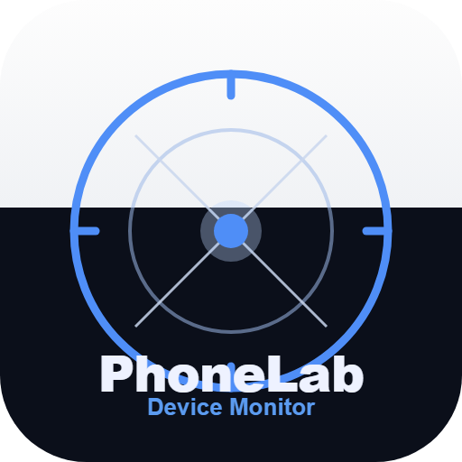
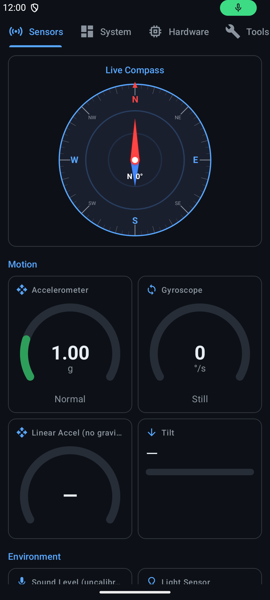
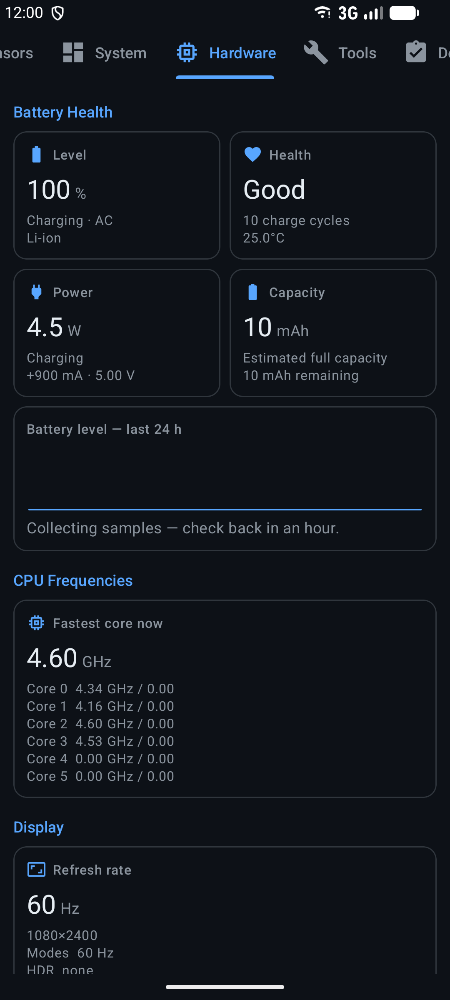
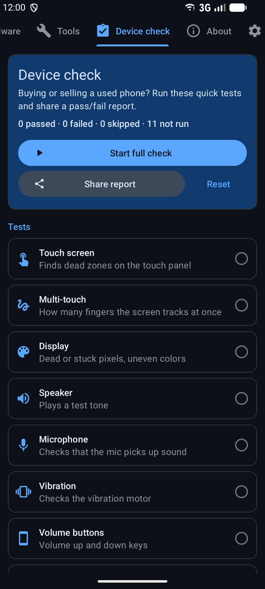
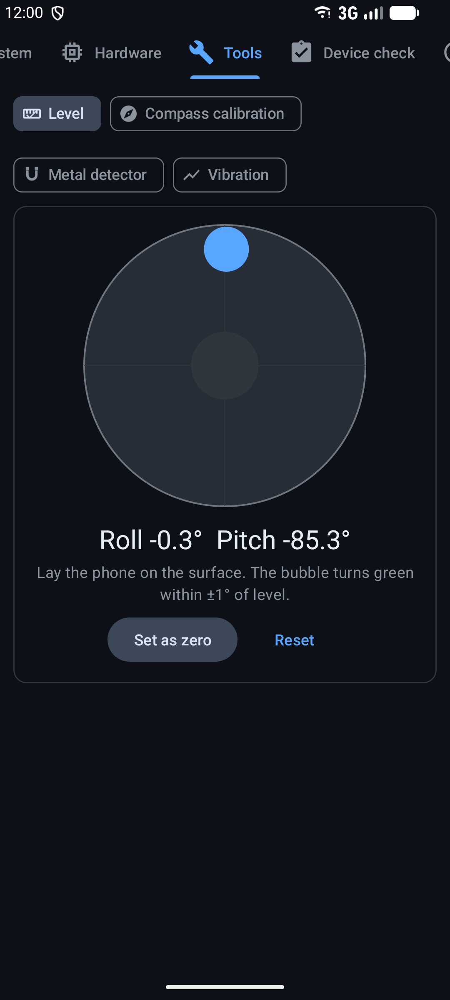
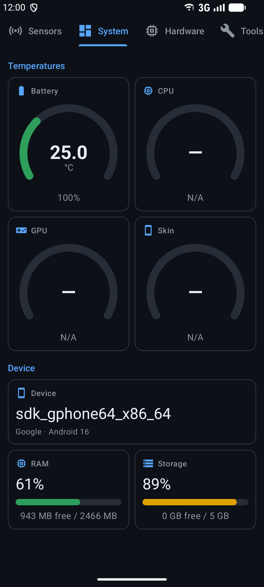
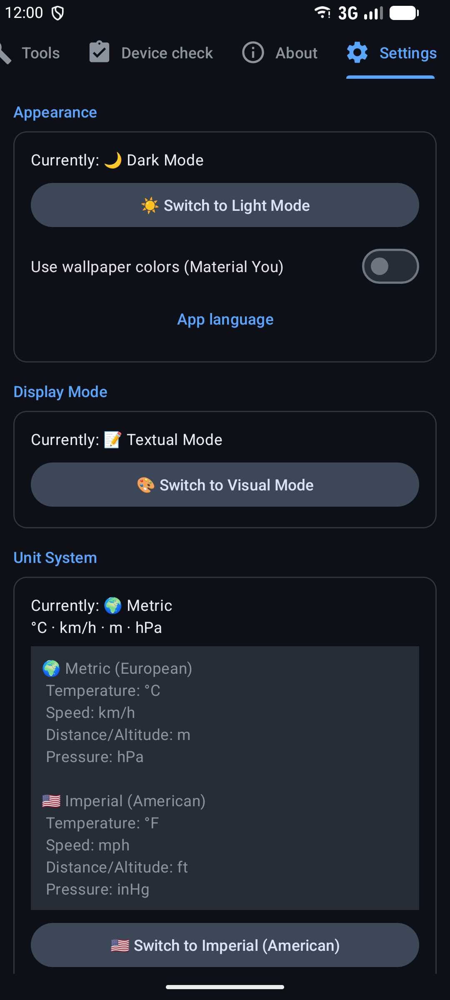

<div align="center">



# PhoneLab

**Cada sensor de hardware, estadística del sistema y zona térmica de tu teléfono — en vivo, en una sola pantalla.**

[](https://github.com/DrummingBird1/PhoneLab/actions/workflows/android-ci.yml)
[](https://github.com/DrummingBird1/PhoneLab/releases/latest)

**Leer en otro idioma:** [English](README.md) · [עברית](README.he.md) · Español · [العربية](README.ar.md)

[**⬇ Descargar el último APK**](https://github.com/DrummingBird1/PhoneLab/releases/latest) · [Sitio web](https://drummingbird1.github.io/PhoneLab/) · [Política de privacidad](https://drummingbird1.github.io/phonelab-privacy/)

</div>

---

## ¿Qué es PhoneLab?

PhoneLab es una app de Android de una sola pantalla para quien quiera saber exactamente qué está haciendo el hardware de su dispositivo en este momento — desarrolladores que prueban el comportamiento de sensores, entusiastas de la tecnología, jugadores vigilando la temperatura, o cualquiera con curiosidad por lo que hay dentro de su teléfono.

Sin anuncios. Sin cuenta. Sin servicios en segundo plano cuando no estás usando la app. La aplicación solo lee sensores y archivos del sistema a los que cualquier app de Android ya tiene acceso — la versión de GitHub / F-Droid **no tiene permiso de internet** (la versión de Google Play añade Google Play Billing para la propina opcional: Google procesa las propinas y recibe los registros de diagnóstico de la biblioteca de facturación, mientras que el propio código de PhoneLab nunca usa la red). Todos los detalles en la [Política de privacidad](https://drummingbird1.github.io/phonelab-privacy/).

## Capturas de pantalla

<div align="center">






</div>

## Funciones

**📡 Pestaña Sensores** — lecturas en vivo de 24 sensores (acelerómetro, giroscopio, magnetómetro, gravedad, vectores de rotación, barómetro, luz, proximidad, humedad, temperatura ambiente, ritmo cardíaco, contador de pasos, detectores de inclinación y movimiento, y más), además de velocidad GPS y un medidor de nivel de sonido en vivo. La disponibilidad de sensores varía según el dispositivo — la app indica claramente qué no tiene tu hardware.

**⚙️ Pestaña Sistema** — modelo del dispositivo, versión de Android, CPU/RAM/almacenamiento, temperaturas de zonas térmicas (CPU/GPU/batería/carcasa y más) con alertas codificadas por color, un benchmark de rendimiento en 4 fases, grabación de sesión en CSV que sigue funcionando en segundo plano mediante un servicio en primer plano, y exportación de especificaciones a un archivo de texto.

**🔧 Pestaña Hardware** — frecuencia de CPU en vivo por núcleo, estadísticas detalladas de batería, capacidades de pantalla (frecuencia de actualización, HDR), e indicadores de capacidades de hardware (NFC, Bluetooth, número de cámaras, registro biométrico).

**🧰 Pestaña Herramientas** — nivel de burbuja, calibración de la brújula, un detector de metales con el magnetómetro y un sismógrafo de vibraciones con análisis de frecuencia.

**✅ Diagnóstico del dispositivo** — 11 pruebas de hardware guiadas (pantalla táctil, multitáctil, pantalla, altavoz, micrófono, vibración, botones, proximidad, linterna, sensores de movimiento, batería) con un informe de aprobado/fallido para compartir — útil al comprar o vender un teléfono usado.

**🔋 Salud de la batería** — estado, potencia de carga en vatios, capacidad estimada, ciclos de carga e historial de nivel de 24 horas.

**🏠 Widget de pantalla de inicio y mosaico de ajustes rápidos** — consulta la temperatura de la CPU sin abrir la app.

**🔔 Alertas** — reglas personalizadas para cualquier lectura ("avísame cuando X supere Y") y alertas de temperatura de la CPU, todas con histéresis para no saturarte de avisos.

**🎨 Dos modos de visualización** — Textual (números en bruto, ideal para desarrolladores) o Visual (iconos, medidores, barras de progreso) — cambia con un toque.

**✨ Material 3** con colores Material You opcionales, **🌙 temas claro y oscuro**, **🌐 4 idiomas** (inglés, hebreo, español, árabe, con soporte completo de RTL), **📐 unidades métricas/imperiales**.

## PhoneLab Web

Un panel de sensores complementario basado en el navegador vive en este repositorio, dentro de [`Web/`](Web/), y funciona en vivo en **[sensolab-web.vercel.app](https://sensolab-web.vercel.app)** — sin instalación. Refleja lo que la plataforma web expone en tu navegador/dispositivo actual: sensores de movimiento y orientación, GPS, luz ambiente, un test de velocidad de internet, y exportación a CSV/PNG de todo lo que lee. Todo se ejecuta en el cliente; no se envía nada a ningún sitio.

## Descargar

- **APK:** descarga `PhoneLab-v<version>.apk` desde la **[página de Releases](https://github.com/DrummingBird1/PhoneLab/releases)** — cada versión detalla qué cambió en lenguaje sencillo.
- **Obtainium:** añade `https://github.com/DrummingBird1/PhoneLab` para recibir actualizaciones directamente desde los releases.
- **F-Droid / IzzyOnDroid:** solicitudes en curso.
- **Google Play:** próximamente.

Las versiones de GitHub / F-Droid (el flavor `foss`) no contienen bibliotecas propietarias ni permiso de internet. La versión de Google Play la firma Google, así que cambiar entre Play y un APK requiere desinstalar primero.

## Compilar desde el código fuente

Requisitos: **JDK 21**, Android SDK 36, y el Gradle wrapper (incluido — no hace falta instalar Gradle aparte).

La app tiene dos flavors: `foss` (GitHub, F-Droid y otras tiendas — sin bibliotecas propietarias) y `play` (Google Play, añade la propina con Play Billing).

```bash
cd App
./gradlew assembleFossDebug    # APK debug → app/build/outputs/apk/foss/debug/
./gradlew assembleFossRelease  # APK release → app/build/outputs/apk/foss/release/
./gradlew test                 # pruebas unitarias JUnit
```

Una compilación release firmada necesita una clave de firma: copia `App/key.properties.template` a `App/key.properties` y completa los datos de tu propio keystore. Sin `key.properties`, las compilaciones release igual se generan — solo que sin firmar.

Consulta [CLAUDE.md](CLAUDE.md) para un recorrido completo de la arquitectura (fragments, clases auxiliares, modelo de permisos, detalles no evidentes) — es el mismo documento de orientación usado para el desarrollo asistido por IA en este repositorio, y también funciona como documentación técnica viva.

## Stack tecnológico

Java, Views clásicas de Android + Material Components (sin Compose), `ViewPager2` + `TabLayout`, `WorkManager` para comprobaciones térmicas en segundo plano, un `Service` en primer plano para la grabación CSV, `TileService` para el mosaico de ajustes rápidos, y `AppWidgetProvider` para el widget de pantalla de inicio. El panel web está hecho con Vite + TypeScript, sin framework.

## Estructura del proyecto

```
PhoneLab/
├── App/            el proyecto Gradle — ábrelo en Android Studio
├── Web/            el panel del navegador (Vite + TypeScript)
├── Assets/         textos de la ficha de la tienda, iconos, capturas, changelogs
├── fastlane/       textos, icono y capturas para las tiendas (F-Droid / IzzyOnDroid)
├── Distribution/   receta de F-Droid y guía de tiendas (compilaciones y claves ignoradas por git)
└── Archive/        instantáneas congeladas de versiones anteriores
```

## Licencia

PhoneLab es software libre bajo la **[Licencia Pública General GNU v3.0](LICENSE)** (GPL-3.0-only). Puedes usarlo, estudiarlo, compartirlo y modificarlo; las versiones modificadas que distribuyas deben mantener la misma licencia con su código fuente disponible.
